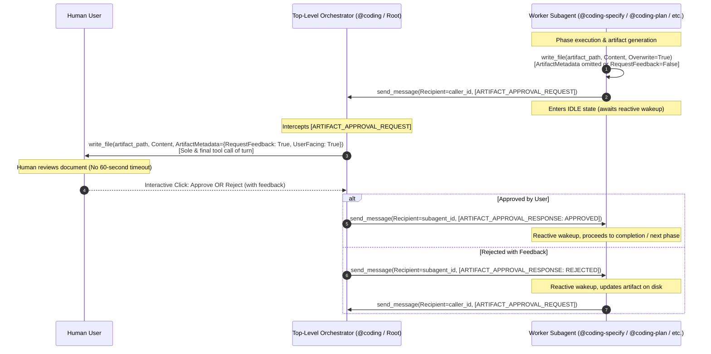

# Technical Specification: Artifact Approval Relay Protocol

## 1. Executive Summary & Problem Motivation

### 1.1 Context
In Google Antigravity, background worker subagents spawned via `invoke_subagent` run within asynchronous execution turns managed by the runtime. These worker subagents are subject to strict per-turn execution timeouts (typically 60 seconds). 

The Agentic workspace previously resolved interactive human-in-the-loop interrogation timeouts by introducing the **Question Relay Protocol** (`[QUESTION_RELAY_REQUEST]` / `[QUESTION_RELAY_RESPONSE]`), ensuring that inquiries prompting user deliberation are executed at the session root turn without timeout constraints.

### 1.2 Problem Statement
A parallel issue exists for interactive approval gates:
When worker subagents (`@coding-specify`, `@coding-plan`, `@coding-deploy`, `@coding-investigate`, `@coding-groom`, `@coding-research`) author deliverables requiring human sign-off (`specification.md`, `plan.md`, `issue-assessment.md`, `Project_Request_Grooming.md`, `research-report.md`) using `write_file` with `ArtifactMetadata={"RequestFeedback": True, "UserFacing": True}`, the interactive Approve/Reject buttons and feedback input box are rendered within the subagent turn.

If human users inspect architectural specifications, plans, or research reports for longer than 60 seconds before clicking **Approve** or providing revision feedback, the runtime throws a timeout exception, prematurely terminating the workflow and losing intermediate progress. Furthermore, nested approval gates can suffer from UI visibility degradation in complex agent hierarchies.

### 1.3 Solution Vision
Standardize the **Artifact Approval Relay Protocol** across all agentic plugins and workspace guidelines, mirroring the architecture of the Question Relay Protocol:
1. Subagents author the artifact file directly into the session artifact directory (`<appDataDir>/brain/<conversation-id>/<artifact_name>`) **without** `RequestFeedback=True`.
2. Subagents dispatch an `[ARTIFACT_APPROVAL_REQUEST]` envelope to their parent orchestrator (`caller_id`) via `send_message` and enter an idle state.
3. The parent orchestrator presents the artifact to the human user using `write_file` with `ArtifactMetadata={"RequestFeedback": True, "UserFacing": True}` as the sole and final tool call of its root turn. At the root level, Antigravity waits indefinitely for user interaction without background tool timeouts.
4. When the user approves or rejects the artifact, the parent orchestrator intercepts the decision and returns an `[ARTIFACT_APPROVAL_RESPONSE]` envelope to the subagent via `send_message`.
5. The subagent wakes up reactively:
   - On approval (`status: "APPROVED"`), the subagent finalizes its phase and signals completion.
   - On rejection/revisions (`status: "REJECTED"`), the subagent parses `feedback`, updates the file on disk, and re-dispatches `[ARTIFACT_APPROVAL_REQUEST]`.

---

## 2. Architecture & Sequence Flow



---

## 3. Standardized Message Protocol Envelopes

### 3.1 Request Envelope: `[ARTIFACT_APPROVAL_REQUEST]`
Dispatched by the worker subagent to the caller orchestrator (`caller_id`):

```text
[ARTIFACT_APPROVAL_REQUEST]
```
```json
{
  "type": "ARTIFACT_APPROVAL_REQUEST",
  "artifact_name": "specification.md",
  "artifact_path": "/Users/user/.gemini/antigravity/brain/session-id/specification.md",
  "stage": "SPECIFICATION",
  "summary": "Detailed technical specification for feature XYZ",
  "user_facing": true
}
```

#### Field Specifications:
- `type` (*string*, required): Must be strictly `"ARTIFACT_APPROVAL_REQUEST"`.
- `artifact_name` (*string*, required): Base file name (e.g. `specification.md`, `plan.md`, `issue-assessment.md`, `research-report.md`, `Project_Request_Grooming.md`).
- `artifact_path` (*string*, required): Absolute file path in `<appDataDir>/brain/<conversation-id>/`.
- `stage` (*string*, required): Identification of the originating workflow stage (e.g. `"SPECIFICATION"`, `"PLANNING"`, `"DEPLOYMENT_ISSUE"`, `"INVESTIGATION"`, `"GROOMING"`, `"RESEARCH"`).
- `summary` (*string*, required): High-level summary of the artifact contents for `ArtifactMetadata.Summary`.
- `user_facing` (*boolean*, required): Defaults to `true`.

---

### 3.2 Response Envelope: `[ARTIFACT_APPROVAL_RESPONSE]`
Dispatched by the caller orchestrator to the waiting worker subagent (`subagent_id`):

```text
[ARTIFACT_APPROVAL_RESPONSE]
```
```json
{
  "type": "ARTIFACT_APPROVAL_RESPONSE",
  "artifact_name": "specification.md",
  "status": "APPROVED",
  "feedback": ""
}
```

#### Field Specifications:
- `type` (*string*, required): Must be strictly `"ARTIFACT_APPROVAL_RESPONSE"`.
- `artifact_name` (*string*, required): The file name matching the corresponding request.
- `status` (*string*, required): `"APPROVED"` or `"REJECTED"`.
- `feedback` (*string*, optional): User-provided revision comments, objections, or adjustment instructions when `status == "REJECTED"`. Empty string if `APPROVED`.

---

## 4. Agent Classification & Behavioral Matrix

| Agent Handle / Capability | Classification | Parent Caller Present (`caller_id` exists) | Standalone Mode (No caller context / root turn) |
| :--- | :--- | :--- | :--- |
| `@coding-specify` | Pure Subagent | Writes file on disk; relays via `[ARTIFACT_APPROVAL_REQUEST]`. Never calls `RequestFeedback=True`. | N/A (Always invoked by `@coding`). |
| `@coding-plan` | Pure Subagent | Writes file on disk; relays via `[ARTIFACT_APPROVAL_REQUEST]`. Never calls `RequestFeedback=True`. | N/A (Always invoked by `@coding`). |
| `@coding-deploy` | Pure Subagent | Writes deployment issue artifact on disk; relays via `[ARTIFACT_APPROVAL_REQUEST]`. | N/A (Always invoked by `@coding`). |
| `@coding-investigate` | Dual-Mode Agent | Relays via `[ARTIFACT_APPROVAL_REQUEST]` to orchestrator. | Directly authors `issue-assessment.md` with `RequestFeedback=True` as sole & final call. |
| `/project-grooming` (`@coding-groom`) | Dual-Mode Agent | Relays via `[ARTIFACT_APPROVAL_REQUEST]` to caller orchestrator. | Directly authors `Project_Request_Grooming.md` with `RequestFeedback=True` as sole & final call. |
| `@coding-research` | Dual-Mode Agent | Relays via `[ARTIFACT_APPROVAL_REQUEST]` to caller orchestrator. | Directly authors `research-report.md` with `RequestFeedback=True` as sole & final call. |
| `@coding` (Orchestrator) | Root Orchestrator | Intercepts `[ARTIFACT_APPROVAL_REQUEST]`, renders `write_file` with `ArtifactMetadata={"RequestFeedback": True}`, awaits user gate, replies `[ARTIFACT_APPROVAL_RESPONSE]`. | Handles top-level workflows. |

---

## 5. Functional Requirements

### 5.1 Workspace Coordination Guide (`AGENTS.md`)
- Add Section **3.3 Artifact Approval Relay Protocol** detailing:
  - The 60-second background execution timeout root cause on `write_file(RequestFeedback=True)`.
  - Architecture sequence diagram for artifact approval relaying.
  - JSON schemas for `[ARTIFACT_APPROVAL_REQUEST]` and `[ARTIFACT_APPROVAL_RESPONSE]`.
  - Pure subagents vs. dual-mode subagent operating procedures.
- Update Section 4 (Flowchart and phase descriptions) to reflect that Phase 2 (`@coding-specify`), Phase 3 (`@coding-plan`), and deployment error gates in Phase 5 (`@coding-deploy`) use the Artifact Approval Relay Protocol instead of direct subagent gate rendering.

### 5.2 Coding Orchestrator & Companion Plugin (`agentic-coding-plugin`)
- Update [rules/AGENTS.md](file:///Users/gpfister/Development/Projects/gpfister/agentic/agentic-coding-plugin/rules/AGENTS.md):
  - Add Section 7 specifying the Artifact Approval Relay Protocol alongside Section 6 (Question Relay Protocol).
  - Explicitly mandate that worker subagents under `@coding` do not present artifacts with `RequestFeedback=True` directly.
- Update [skills/coding-orchestrator/SKILL.md](file:///Users/gpfister/Development/Projects/gpfister/agentic/agentic-coding-plugin/skills/coding-orchestrator/SKILL.md):
  - Add request handlers in orchestrator lifecycle for `[ARTIFACT_APPROVAL_REQUEST]`.
  - Orchestrator inspects artifact file on disk, calls `write_file(Path=artifact_path, Content=..., ArtifactMetadata={"RequestFeedback": True, "UserFacing": True})` as sole tool call of turn.
  - On user gate trigger, orchestrator wakes up, packages decision into `[ARTIFACT_APPROVAL_RESPONSE]`, and calls `send_message(Recipient=subagent_id, ...)`.
- Update Subagent instructions:
  - `@coding-specify`: Write `specification.md` without feedback gate; send `[ARTIFACT_APPROVAL_REQUEST]`; await `[ARTIFACT_APPROVAL_RESPONSE]`; advance or rework.
  - `@coding-plan`: Write `plan.md` without feedback gate; send `[ARTIFACT_APPROVAL_REQUEST]`; await `[ARTIFACT_APPROVAL_RESPONSE]`; advance or rework.
  - `@coding-deploy`: Write deployment issue artifact without feedback gate; send `[ARTIFACT_APPROVAL_REQUEST]`; await `[ARTIFACT_APPROVAL_RESPONSE]`.

### 5.3 Issue Investigation Plugin (`agentic-issue-investigation-plugin`)
- Update [rules/AGENTS.md](file:///Users/gpfister/Development/Projects/gpfister/agentic/agentic-issue-investigation-plugin/rules/AGENTS.md):
  - Extend Section 2 (Approval Gates & Question Relay Protocol) to include Artifact Approval Relay Protocol for `issue-assessment.md`.
  - In subagent mode (`caller_id` present), relay `issue-assessment.md` via `[ARTIFACT_APPROVAL_REQUEST]`.
  - In standalone mode, retain direct `write_file(RequestFeedback=True)` as sole and final tool call.
- Update [skills/coding-investigate/SKILL.md](file:///Users/gpfister/Development/Projects/gpfister/agentic/agentic-issue-investigation-plugin/skills/coding-investigate/SKILL.md) and agent prompts.

### 5.4 Project Grooming Plugin (`agentic-project-grooming-plugin`)
- Update [rules/AGENTS.md](file:///Users/gpfister/Development/Projects/gpfister/agentic/agentic-project-grooming-plugin/rules/AGENTS.md):
  - Update Section 3 (Approval Gate & Artifact Protocol) to describe dual-mode behavior for `Project_Request_Grooming.md`.
  - If spawned by an orchestrator, relay via `[ARTIFACT_APPROVAL_REQUEST]`.
  - If run top-level via `/project-grooming`, author directly with `RequestFeedback=True`.
- Update [skills/project-grooming/SKILL.md](file:///Users/gpfister/Development/Projects/gpfister/agentic/agentic-project-grooming-plugin/skills/project-grooming/SKILL.md).

### 5.5 Topic Researching Plugin (`agentic-topic-researching-plugin`)
- Update [rules/AGENTS.md](file:///Users/gpfister/Development/Projects/gpfister/agentic/agentic-topic-researching-plugin/rules/AGENTS.md):
  - Update Section 2 (Interactive Approval Gates & Clarification) to specify dual-mode relaying for `research-report.md`.
  - Relay via `[ARTIFACT_APPROVAL_REQUEST]` when running under a caller orchestrator.
  - Author directly with `RequestFeedback=True` in standalone mode.
- Update [skills/coding-research/SKILL.md](file:///Users/gpfister/Development/Projects/gpfister/agentic/agentic-topic-researching-plugin/skills/coding-research/SKILL.md).

---

## 6. Non-Functional Requirements

### 6.1 Reliability & Resilience
- **Zero Subagent Timeouts**: Worker subagents must never block inside a tool execution turn awaiting human approval.
- **State Integrity**: Artifact files must be written to disk in full before dispatching `[ARTIFACT_APPROVAL_REQUEST]`, ensuring the orchestrator and user have access to the latest content.
- **Deterministic Rework Loop**: Rejection feedback must be forwarded verbatim to the worker subagent so edits directly reflect user desires.

### 6.2 Ergonomics & UX
- **Native UI Integration**: Interactive Antigravity Approve and Reject buttons must render at the top-level session chat stream without manual string typing by the user.
- **Sole and Final Tool Call Rule**: The parent orchestrator must adhere to executing `write_file` with `RequestFeedback=True` as the sole and final tool call of the turn to ensure buttons render properly.

---

## 7. Edge Cases & Mitigations

| Edge Case | Potential Impact | Mitigation Strategy |
| :--- | :--- | :--- |
| **Missing Orchestrator Relay Handler** | If a caller does not understand `[ARTIFACT_APPROVAL_REQUEST]`, workflow hangs. | Pure subagents mandate orchestration under `@coding`. Dual-mode agents verify caller capabilities or fallback to direct presentation if caller context is absent. |
| **User Submits Rejection with Empty Feedback** | Subagent cannot discern what to modify. | Orchestrator response includes empty feedback; subagent checks if feedback is empty and dispatches a single clarification question via `[QUESTION_RELAY_REQUEST]` asking what needs revision. |
| **Concurrent Artifacts** | Multiple background tasks or subagents submitting approval requests at the same time. | Orchestrator queues approval gates sequentially; each artifact gate is presented one turn at a time. |
| **File Read Failure at Root** | Orchestrator fails to load subagent's artifact file. | Subagent writes to standardized path `<appDataDir>/brain/<conversation-id>/<artifact_name>` and provides the absolute path in the request envelope. Orchestrator verifies file existence prior to presenting. |

---

## 8. Verifiable Acceptance Criteria

1. **Protocol Definitions**: Workspace root [AGENTS.md](file:///Users/gpfister/Development/Projects/gpfister/agentic/AGENTS.md) contains Section 3.3 detailing the complete Artifact Approval Relay Protocol specification, sequence diagram, and envelope schemas.
2. **Plugin Rule Consistency**:
   - [agentic-coding-plugin/rules/AGENTS.md](file:///Users/gpfister/Development/Projects/gpfister/agentic/agentic-coding-plugin/rules/AGENTS.md) specifies artifact relaying for `@coding-specify`, `@coding-plan`, and `@coding-deploy`.
   - [agentic-issue-investigation-plugin/rules/AGENTS.md](file:///Users/gpfister/Development/Projects/gpfister/agentic/agentic-issue-investigation-plugin/rules/AGENTS.md) specifies dual-mode artifact relaying for `issue-assessment.md`.
   - [agentic-project-grooming-plugin/rules/AGENTS.md](file:///Users/gpfister/Development/Projects/gpfister/agentic/agentic-project-grooming-plugin/rules/AGENTS.md) specifies dual-mode artifact relaying for `Project_Request_Grooming.md`.
   - [agentic-topic-researching-plugin/rules/AGENTS.md](file:///Users/gpfister/Development/Projects/gpfister/agentic/agentic-topic-researching-plugin/rules/AGENTS.md) specifies dual-mode artifact relaying for `research-report.md`.
3. **Skill & Prompt Alignment**:
   - `coding-orchestrator/SKILL.md` documents intercepting `[ARTIFACT_APPROVAL_REQUEST]` and returning `[ARTIFACT_APPROVAL_RESPONSE]`.
   - All associated skill runbooks and prompt files reflect the non-blocking relay flow.
4. **Clean Execution**: Documentation changes adhere to Markdown formatting standards, valid Mermaid diagrams, and valid JSON schemas.
