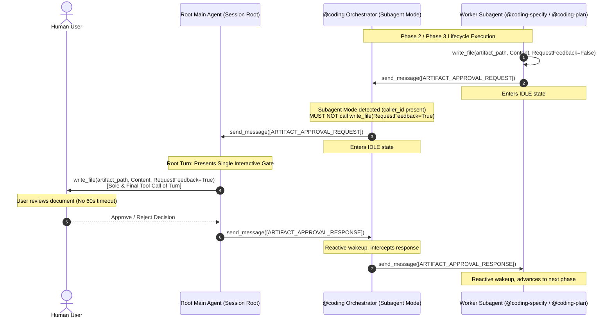

# Technical Specification: Dual-Mode Multi-Hop Relay & Anti-Direct-Coding Guardrails in `@coding` Orchestrator

## 1. Summary & Problem Motivation

### 1.1 Context
In the Antigravity multi-agent workspace, [`@coding`](file:///Users/gpfister/Development/Projects/gpfister/agentic/agentic-coding-plugin/agents/coding/agent.md) acts as the central workflow orchestrator for the 7-stage software development lifecycle (`coding-clarify` $\rightarrow$ `coding-specify` $\rightarrow$ `coding-plan` $\rightarrow$ `coding-develop` $\rightarrow$ `coding-deploy` $\rightarrow$ `coding-review` $\rightarrow$ `coding-merge`). 

However, two critical production defects were uncovered during operational runs:
1. **Duplicate Artifact Approval Gates & 60-Second Timeout Failures** ([`5ae77de8-7611-4aec-b4d6-a54c29e985e9/issue-assessment.md`](file:///Users/gpfister/.gemini/antigravity/brain/5ae77de8-7611-4aec-b4d6-a54c29e985e9/issue-assessment.md)):
   When `@coding` is spawned as a child subagent by the Main Agent (3-tier runtime execution), `@coding` assumed it was running at the session root and invoked `write_file(RequestFeedback=True)` in its child directory. Meanwhile, the root Main Agent also intercepted the idle subagent and invoked `write_file(RequestFeedback=True)` at the session root. This created duplicate interactive UI approval buttons for `specification.md` and `plan.md`. Furthermore, `@coding` directly called `ask_question` during Phase 1 clarification, suffering consecutive 60-second subagent execution timeout failures.
2. **Bypassed 7-Stage Workflow & Direct Source Code Manipulation** ([`61dd7836-39b2-4da3-8bba-20ff4c58a615/issue-assessment.md`](file:///Users/gpfister/.gemini/antigravity/brain/61dd7836-39b2-4da3-8bba-20ff4c58a615/issue-assessment.md)):
   When `@coding` was invoked with an imperative prompt containing pre-clarified remediation steps, the orchestrator bypassed the entire 7-stage workflow. Having `write_file` and `run_command` in its toolset without hard anti-direct-coding guardrails, `@coding` directly edited application source code and executed build/test commands, omitting lifecycle subagents, approval gates, and documentation archival.

### 1.2 Objective
Implement **Solution 1** of both Issue Assessment Reports:
1. Elevate `@coding` to a **Dual-Mode Orchestrator** supporting Multi-Hop Relay for both interactive artifact approval gates (`[ARTIFACT_APPROVAL_REQUEST]`) and user clarification questions (`[QUESTION_RELAY_REQUEST]`).
2. Strengthen `@coding` system instructions with **Anti-Direct-Coding Guardrails**, constrained tool boundaries, a **Pre-Clarified Fast-Path**, and standardized upstream invocation patterns.
3. Validate all changes with comprehensive unit tests in [`agentic-coding-plugin/tests/test_plugin.py`](file:///Users/gpfister/Development/Projects/gpfister/agentic/agentic-coding-plugin/tests/test_plugin.py).

---

## 2. Architecture & Design

### 2.1 Dual-Mode Orchestration Architecture



### 2.2 Subagent Tier Classification Update

Update the Dual-Mode classification matrix to include `@coding`:

| Tier | Agents | Operating Protocol | Tooling Permissions |
| :--- | :--- | :--- | :--- |
| **Pure Subagents** | `@coding-clarify`<br>`@coding-specify`<br>`@coding-plan`<br>`@coding-develop`<br>`@coding-deploy`<br>`@coding-review`<br>`@coding-merge` | Strictly run under `@coding`. **NEVER** call `ask_question` or `write_file(RequestFeedback=True)`. Always dispatch `[QUESTION_RELAY_REQUEST]` and `[ARTIFACT_APPROVAL_REQUEST]` to `caller_id`. | `send_message`, `write_file` (without `RequestFeedback=True`), specialized domain tools. |
| **Dual-Mode Orchestrators & Agents** | **`@coding`**<br>`@coding-investigate`<br>`/project-grooming` (`@coding-groom`)<br>`@coding-monitor`<br>`@coding-research` | **Subagent Mode (`caller_id` present)**:<br>• Relay `[ARTIFACT_APPROVAL_REQUEST]` up to `caller_id` via `send_message`.<br>• Relay `[QUESTION_RELAY_REQUEST]` up to `caller_id` via `send_message`.<br>• Forward responses down to requesting worker subagent.<br>**Standalone Mode (no `caller_id`)**:<br>• Call `write_file(RequestFeedback=True)` directly as sole and final tool call of turn.<br>• Call `ask_question` directly. | `send_message`, `invoke_subagent`, `ask_question`, `write_file` (strictly for gates in standalone mode), inspection tools. |

---

## 3. Functional Requirements

### Requirement 1: Dual-Mode & Multi-Hop Relay in `@coding`
1. **Execution Mode Detection**:
   `@coding` must inspect its execution context on startup and on every turn:
   - If a caller ID is present (e.g. in `<subagent_reminder>`, prompt context, or parent metadata), `@coding` operates in **Subagent Mode**.
   - If no caller ID is present (invoked directly at the root session), `@coding` operates in **Standalone Mode**.

2. **Subagent Mode Behavior (`caller_id` present)**:
   - **Artifact Approval Relay**:
     When receiving `[ARTIFACT_APPROVAL_REQUEST]` from a worker subagent (`@coding-specify`, `@coding-plan`, `@coding-deploy`):
     - `@coding` **MUST NOT** call `write_file(RequestFeedback=True)` or create local metadata.
     - `@coding` forwards the `[ARTIFACT_APPROVAL_REQUEST]` payload directly to `caller_id` via `send_message`.
     - `@coding` terminates its turn immediately, remaining idle until receiving `[ARTIFACT_APPROVAL_RESPONSE]` from `caller_id`.
     - Upon receiving `[ARTIFACT_APPROVAL_RESPONSE]` from `caller_id`, `@coding` forwards the response down to the worker subagent via `send_message` and coordinates lifecycle phase transitions.
   - **Question Relay**:
     When receiving `[QUESTION_RELAY_REQUEST]` from a worker subagent (`@coding-clarify`, `@coding-deploy`, `@coding-review`, `@coding-merge`):
     - `@coding` **MUST NOT** call `ask_question` directly.
     - `@coding` forwards the `[QUESTION_RELAY_REQUEST]` payload directly to `caller_id` via `send_message`.
     - `@coding` terminates its turn immediately, remaining idle until receiving `[QUESTION_RELAY_RESPONSE]` from `caller_id`.
     - Upon receiving `[QUESTION_RELAY_RESPONSE]` from `caller_id`, `@coding` forwards the response down to the worker subagent via `send_message`.

3. **Standalone Mode Behavior (no `caller_id`)**:
   - When receiving `[ARTIFACT_APPROVAL_REQUEST]`, `@coding` reads the artifact from disk and calls `write_file(Path=artifact_path, Content=..., Overwrite=True, ArtifactMetadata={"RequestFeedback": True, "UserFacing": True, "Summary": summary})` as the **sole and final tool call of that turn**.
   - When receiving `[QUESTION_RELAY_REQUEST]`, `@coding` prompts the user directly via `ask_question`.

### Requirement 2: Hard Anti-Direct-Coding Guardrails in `@coding`
1. **Explicit Role Boundary**:
   `@coding` is strictly a meta-orchestrator. System instructions across [`agent.md`](file:///Users/gpfister/Development/Projects/gpfister/agentic/agentic-coding-plugin/agents/coding/agent.md), [`SKILL.md`](file:///Users/gpfister/Development/Projects/gpfister/agentic/agentic-coding-plugin/skills/coding-orchestrator/SKILL.md), and rules must explicitly enforce:
   > *"You are strictly a meta-orchestrator. You MUST NEVER write, edit, or delete application source code, configuration files, Makefiles, build scripts, or test suites directly. All implementation work must be delegated to `@coding-develop`. All deployment and health checks must be delegated to `@coding-deploy`. All code audits must be delegated to `@coding-review`. All merges and releases must be delegated to `@coding-merge`."*

2. **Constrained Tool Usage**:
   - `write_file`: Strictly permitted ONLY for presenting interactive approval gate artifacts (`<appDataDir>/brain/<id>/*.md`) in Standalone Mode. Any attempt to call `write_file` on workspace or repository paths is strictly forbidden.
   - `run_command`: Strictly restricted to workspace inspection/status queries (e.g. `git status`). `@coding` MUST NEVER execute build commands (`make`, `go build`, `npm run build`), test suites (`pytest`, `go test`), or deployment scripts.

3. **Pre-Clarified Fast-Path**:
   When `@coding` is invoked with a prompt that provides a pre-clarified technical specification, approved architecture document, or approved issue assessment report (such as handoffs from `@coding-investigate` or `/project-grooming`):
   - `@coding` detects that requirements and root-cause analysis are already established.
   - `@coding` **skips Phase 1 (`@coding-clarify`)**.
   - `@coding` fast-paths directly to **Phase 2 (`@coding-specify`)** to record `specification.md` (or directly to **Phase 3 (`@coding-plan`)** if a specification already exists on disk).
   - `@coding` ensures the formal approval gates (`specification.md`, `plan.md`) are executed before any development worker is spawned.

4. **Standardized Upstream Invocation Protocol**:
   Update caller instructions in [`AGENTS.md`](file:///Users/gpfister/Development/Projects/gpfister/agentic/AGENTS.md) and [`agentic-issue-investigation-plugin/rules/AGENTS.md`](file:///Users/gpfister/Development/Projects/gpfister/agentic/agentic-issue-investigation-plugin/rules/AGENTS.md) so upstream callers formulate orchestration requests unambiguously:
   ```text
   Orchestrate the 7-stage software development lifecycle to implement the following feature / correction based on the approved assessment: <details/path>. Do not implement directly; delegate all phases through worker subagents.
   ```

---

## 4. Non-Functional Requirements

1. **Timeout Mitigation & Safety**:
   Zero background subagent execution timeouts ($<60\text{s}$) during human deliberation. All blocking user interactions must occur exclusively at the foreground root turn.
2. **Protocol Compatibility**:
   Multi-hop envelope schemas (`[ARTIFACT_APPROVAL_REQUEST]`, `[ARTIFACT_APPROVAL_RESPONSE]`, `[QUESTION_RELAY_REQUEST]`, `[QUESTION_RELAY_RESPONSE]`) must maintain exact JSON structures and forward payloads transparently without data loss.
3. **Idempotency & Clean Architecture**:
   Preserve strict separation of concerns. Worker subagents retain pure subagent status; `@coding` retains meta-orchestrator status; only leaf workers manipulate domain files.

---

## 5. Affected Repositories & Files

| Repository | File Path | Scope of Changes |
| :--- | :--- | :--- |
| `agentic-coding-plugin` | [`agents/coding/agent.md`](file:///Users/gpfister/Development/Projects/gpfister/agentic/agentic-coding-plugin/agents/coding/agent.md) | Update agent description, lifecycle flowchart, Dual-Mode multi-hop relay rules, hard anti-direct-coding constraints, tool restriction clauses, and pre-clarified fast-path instructions. |
| `agentic-coding-plugin` | [`skills/coding-orchestrator/SKILL.md`](file:///Users/gpfister/Development/Projects/gpfister/agentic/agentic-coding-plugin/skills/coding-orchestrator/SKILL.md) | Document Dual-Mode orchestrator execution, multi-hop relay flows, anti-direct-coding rules, and pre-clarified fast-path. |
| `agentic-coding-plugin` | [`rules/AGENTS.md`](file:///Users/gpfister/Development/Projects/gpfister/agentic/agentic-coding-plugin/rules/AGENTS.md) | Update Section 6 (Question Relay) and Section 7 (Artifact Approval Relay) to document `@coding` as Dual-Mode and detail multi-hop relay. |
| `agentic-coding-plugin` | [`agents/agent.md`](file:///Users/gpfister/Development/Projects/gpfister/agentic/agentic-coding-plugin/agents/agent.md) | Update central catalog subagent matrices, protocol descriptions, and `@coding` responsibilities. |
| `agentic-coding-plugin` | [`tests/test_plugin.py`](file:///Users/gpfister/Development/Projects/gpfister/agentic/agentic-coding-plugin/tests/test_plugin.py) | Add automated unit tests asserting Dual-Mode classification, multi-hop relay protocol contracts, anti-direct-coding guardrails, and pre-clarified fast-path. |
| `agentic` (Workspace Root) | [`AGENTS.md`](file:///Users/gpfister/Development/Projects/gpfister/agentic/AGENTS.md) | Update Section 2.3, Section 3.1, Section 3.2, Section 3.3, subagent categorization tables, and upstream invocation instructions. |
| `agentic-issue-investigation-plugin` | [`rules/AGENTS.md`](file:///Users/gpfister/Development/Projects/gpfister/agentic/agentic-issue-investigation-plugin/rules/AGENTS.md) | Update Remediation Confirmation Gate instructions to use the standardized upstream orchestration invocation template when invoking `@coding`. |

---

## 6. Edge Cases & Mitigations

| Edge Case | Description | Mitigation Strategy |
| :--- | :--- | :--- |
| **Nested Subagent Idle State** | Antigravity fires `Subagent <id> has gone idle` when child subagents await relayed approval. | `@coding` explicit idle guard: upon forwarding `[ARTIFACT_APPROVAL_REQUEST]`, `@coding` terminates turn immediately and ignores intermediate child idle notifications until root caller sends response. |
| **Rejection with Feedback in Subagent Mode** | User rejects `specification.md` or `plan.md` at root and enters feedback comments. | Root Main Agent packages feedback into `[ARTIFACT_APPROVAL_RESPONSE]` (`status: "REJECTED"`, `feedback: "..."`). `@coding` forwards envelope intact to requesting subagent, then routes workflow back to Phase 1 or previous phase. |
| **Ambiguous Invocation Context** | Agent environment does not provide explicit `caller_id` field. | Inspect `<subagent_reminder>` block for `caller agent (name: "...", id: "...")`. If present, bind `caller_id` and enter Subagent Mode. If absent, default to Standalone Mode. |
| **Pre-Clarified Prompt with Informal Scope** | Caller provides some requirements but leaves edge cases undefined. | Fast-path skips Phase 1 (`coding-clarify`), but Phase 2 (`coding-specify`) rigorously audits ambiguities; if gaps remain, `coding-specify` initiates question relay back to caller. |

---

## 7. Verifiable Acceptance Criteria

- [ ] **Dual-Mode Matrix Consistency**:
  `@coding` is categorized as a Dual-Mode Orchestrator in `agentic-coding-plugin/rules/AGENTS.md`, `agentic-coding-plugin/skills/coding-orchestrator/SKILL.md`, `agentic-coding-plugin/agents/coding/agent.md`, and workspace root `AGENTS.md`.
- [ ] **Multi-Hop Relay Rules**:
  Documentation across all four files specifies that in Subagent Mode (`caller_id` present), `@coding` forwards `[ARTIFACT_APPROVAL_REQUEST]` and `[QUESTION_RELAY_REQUEST]` to `caller_id` via `send_message`, and does NOT invoke `write_file(RequestFeedback=True)` or `ask_question`.
- [ ] **Anti-Direct-Coding Guardrails**:
  `agentic-coding-plugin/agents/coding/agent.md` and `SKILL.md` explicitly specify that `@coding` MUST NEVER edit application source code, configuration files, Makefiles, or test suites directly, and restricts `write_file` solely to approval gate presentation in standalone mode.
- [ ] **Pre-Clarified Fast-Path**:
  `@coding` instructions document skipping Phase 1 (`coding-clarify`) and fast-pathing to Phase 2/3 when invoked with pre-clarified requirements or approved issue assessments.
- [ ] **Standardized Upstream Invocation Template**:
  `AGENTS.md` and `agentic-issue-investigation-plugin/rules/AGENTS.md` provide the standardized prompt template for invoking `@coding`.
- [ ] **Automated Test Suite Pass**:
  New unit tests in `agentic-coding-plugin/tests/test_plugin.py` assert:
  1. Dual-mode classification of `@coding`.
  2. Multi-hop relay specifications for artifact approval and questions.
  3. Anti-direct-coding negative constraints and tool boundary rules.
  4. Pre-clarified fast-path handling.
  Running `agentic-coding-plugin/.venv/bin/pytest agentic-coding-plugin/tests/` passes with 100% success.
