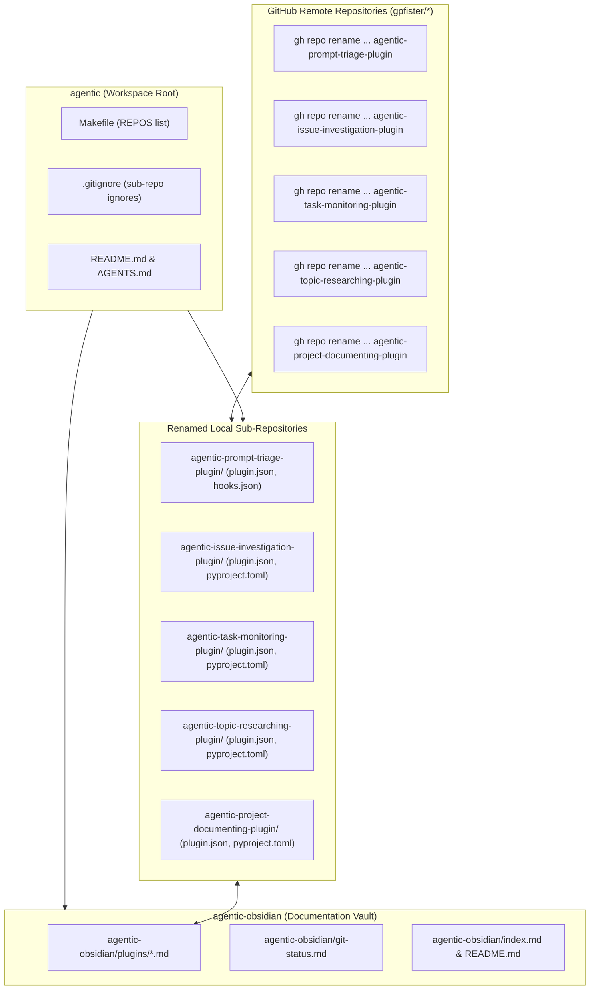

# Technical Specification: Plugin Repository Renaming & Standardization

> [!NOTE]
> **Specification ID**: `SPEC-2026-PLUGIN-RENAME-001`  
> **Status**: Approved by User  
> **Target Branch**: `master` (across workspace root and all affected sub-repositories)  
> **Scope**: Remote GitHub repository rename (`gh repo rename`), local directory rename, Git remote reconfiguration, package manifest alignment, root workspace orchestration, and cross-plugin references.

---

## 1. Summary & Motivation

The `agentic` workspace contains multiple standalone sub-repositories for Google Antigravity plugins. To establish consistency across plugin names (aligning with the descriptive pattern exemplified by `agentic-project-grooming-plugin`), 5 plugin repositories require renaming both on GitHub remotely and within the local workspace environment:

| Current Repository Name | New Repository Name | Remote Git Target (`origin`) | GitHub Remote Rename Command |
| :--- | :--- | :--- | :--- |
| `agentic-triage-plugin` | `agentic-prompt-triage-plugin` | `git@github.com:gpfister/agentic-prompt-triage-plugin.git` | `gh repo rename agentic-prompt-triage-plugin --repo gpfister/agentic-triage-plugin --yes` |
| `agentic-investigate-plugin` | `agentic-issue-investigation-plugin` | `git@github.com:gpfister/agentic-issue-investigation-plugin.git` | `gh repo rename agentic-issue-investigation-plugin --repo gpfister/agentic-investigate-plugin --yes` |
| `agentic-monitor-plugin` | `agentic-task-monitoring-plugin` | `git@github.com:gpfister/agentic-task-monitoring-plugin.git` | `gh repo rename agentic-task-monitoring-plugin --repo gpfister/agentic-monitor-plugin --yes` |
| `agentic-research-plugin` | `agentic-topic-researching-plugin` | `git@github.com:gpfister/agentic-topic-researching-plugin.git` | `gh repo rename agentic-topic-researching-plugin --repo gpfister/agentic-research-plugin --yes` |
| `agentic-document-plugin` | `agentic-project-documenting-plugin` | `git@github.com:gpfister/agentic-project-documenting-plugin.git` | `gh repo rename agentic-project-documenting-plugin --repo gpfister/agentic-document-plugin --yes` |

Unchanged repositories:
- `agentic-coding-plugin`
- `agentic-project-grooming-plugin`
- `agentic-obsidian`
- `agentic` (root orchestration workspace)

> [!IMPORTANT]
> **Subagent Handle & Skill Stability**: To prevent runtime regressions in subagent dispatch, orchestration prompts, and tool calls, all subagent handles (`@coding-document`, `@coding-investigate`, `@coding-monitor`, `@coding-research`), slash commands, and internal skill folder paths remain unchanged.

---

## 2. Architecture & Dependency Flow

---

## 3. Detailed Functional Requirements

### 3.1 Remote GitHub Repository Renaming
1. **GitHub CLI Execution**:
   - Rename each GitHub repository using GitHub CLI (`gh` authenticated as user `gpfister`):
     - `gh repo rename agentic-prompt-triage-plugin --repo gpfister/agentic-triage-plugin --yes`
     - `gh repo rename agentic-issue-investigation-plugin --repo gpfister/agentic-investigate-plugin --yes`
     - `gh repo rename agentic-task-monitoring-plugin --repo gpfister/agentic-monitor-plugin --yes`
     - `gh repo rename agentic-topic-researching-plugin --repo gpfister/agentic-research-plugin --yes`
     - `gh repo rename agentic-project-documenting-plugin --repo gpfister/agentic-document-plugin --yes`

### 3.2 Sub-Repository Folder & Git Remote Updates
1. **Directory Renaming**:
   - Move local directory paths on disk:
     - `agentic-triage-plugin` &rarr; `agentic-prompt-triage-plugin`
     - `agentic-investigate-plugin` &rarr; `agentic-issue-investigation-plugin`
     - `agentic-monitor-plugin` &rarr; `agentic-task-monitoring-plugin`
     - `agentic-research-plugin` &rarr; `agentic-topic-researching-plugin`
     - `agentic-document-plugin` &rarr; `agentic-project-documenting-plugin`
2. **Git Remote Configuration**:
   - In each of the 5 renamed sub-repositories, update Git remote URL for `origin`:
     - Run `git remote set-url origin git@github.com:gpfister/<new-repo-name>.git` within each directory.
     - Validate via `git remote -v`.

### 3.3 Manifest & Package Configuration Updates
1. **Plugin Manifest (`plugin.json`)**:
   - In each renamed repository, update `"name"` to match the new repository directory name exactly (e.g., `"name": "agentic-prompt-triage-plugin"`).
   - Verify descriptions and referenced files remain valid.
2. **Python Packaging (`pyproject.toml`)**:
   - Where present in the renamed plugins, update `name = "<new-repo-name>"` under `[project]`.
3. **Subagent & Skill Preservations**:
   - Subagent identifiers in `agents/*.json` or skill definitions must keep their active names (`coding-document`, `coding-investigate`, `coding-monitor`, `coding-research`).

### 3.4 Root Workspace Automation & Manifests
1. **[`Makefile`](file:///Users/gpfister/Development/Projects/gpfister/agentic/Makefile)**:
   - Update `REPOS` list to substitute old plugin directory names with the new names.
   - Ensure all Makefile targets (`make sync`, `make pull`, `make status`, `make diff`, `make push`) iterate over the updated list without error.
2. **[`.gitignore`](file:///Users/gpfister/Development/Projects/gpfister/agentic/.gitignore)**:
   - Update ignored sub-repository entries to match the new directory names.
3. **Root Documentation**:
   - Update [`README.md`](file:///Users/gpfister/Development/Projects/gpfister/agentic/README.md) workspace catalog and repository layout diagrams.
   - Update [`AGENTS.md`](file:///Users/gpfister/Development/Projects/gpfister/agentic/AGENTS.md) workspace tree, plugin references, and interoperability matrices.

### 3.5 Cross-Plugin Reference Alignment
1. **`agentic-coding-plugin`**:
   - Update [`agentic-coding-plugin/rules/AGENTS.md`](file:///Users/gpfister/Development/Projects/gpfister/agentic/agentic-coding-plugin/rules/AGENTS.md) to reference the new plugin names (`agentic-project-documenting-plugin`, `agentic-issue-investigation-plugin`, etc.) while retaining subagent handles.
   - Update references in [`agentic-coding-plugin/README.md`](file:///Users/gpfister/Development/Projects/gpfister/agentic/agentic-coding-plugin/README.md) and skills where plugin repository paths are cited.
2. **`agentic-project-grooming-plugin`**:
   - Update [`agentic-project-grooming-plugin/rules/AGENTS.md`](file:///Users/gpfister/Development/Projects/gpfister/agentic/agentic-project-grooming-plugin/rules/AGENTS.md) and [`README.md`](file:///Users/gpfister/Development/Projects/gpfister/agentic/agentic-project-grooming-plugin/README.md) for renamed companion plugins.
3. **Renamed Plugins' Internal Docs**:
   - Update internal `README.md`, `rules/AGENTS.md`, and references within each renamed repository.

### 3.6 Obsidian Documentation Vault (`agentic-obsidian`)
1. **Note Renaming (`agentic-obsidian/plugins/`)**:
   - Rename note files:
     - `agentic-obsidian/plugins/agentic-triage-plugin.md` &rarr; `agentic-obsidian/plugins/agentic-prompt-triage-plugin.md`
     - `agentic-obsidian/plugins/agentic-investigate-plugin.md` &rarr; `agentic-obsidian/plugins/agentic-issue-investigation-plugin.md`
     - `agentic-obsidian/plugins/agentic-monitor-plugin.md` &rarr; `agentic-obsidian/plugins/agentic-task-monitoring-plugin.md`
     - `agentic-obsidian/plugins/agentic-research-plugin.md` &rarr; `agentic-obsidian/plugins/agentic-topic-researching-plugin.md`
     - `agentic-obsidian/plugins/agentic-document-plugin.md` &rarr; `agentic-obsidian/plugins/agentic-project-documenting-plugin.md`
2. **Vault Index & Tracking Updates**:
   - Update [`agentic-obsidian/README.md`](file:///Users/gpfister/Development/Projects/gpfister/agentic/agentic-obsidian/README.md).
   - Update [`agentic-obsidian/index.md`](file:///Users/gpfister/Development/Projects/gpfister/agentic/agentic-obsidian/index.md).
   - Update [`agentic-obsidian/git-status.md`](file:///Users/gpfister/Development/Projects/gpfister/agentic/agentic-obsidian/git-status.md) repository tables and remote URLs.
   - Update all Obsidian internal wikilinks (`[[...]]`) across vault notes to target the renamed notes.

---

## 4. Affected Repositories & Files

| Repository | Files Affected | Description of Changes |
| :--- | :--- | :--- |
| **GitHub Remote** | `gpfister/*` | Renamed via `gh repo rename` across all 5 plugins. |
| **`agentic`** (Root) | `Makefile`, `.gitignore`, `README.md`, `AGENTS.md` | Update `REPOS` list, `.gitignore` entries, layout trees, and reference tables. |
| **`agentic-prompt-triage-plugin`** | `plugin.json`, `README.md`, `rules/AGENTS.md`, `hooks.json`, `.git/config` | Rename directory, update plugin manifest name, remote URL, and docs. |
| **`agentic-issue-investigation-plugin`** | `plugin.json`, `pyproject.toml` (if present), `README.md`, `rules/AGENTS.md`, `.git/config` | Rename directory, update manifest name, remote URL, and docs. |
| **`agentic-task-monitoring-plugin`** | `plugin.json`, `pyproject.toml` (if present), `README.md`, `rules/AGENTS.md`, `.git/config` | Rename directory, update manifest name, remote URL, and docs. |
| **`agentic-topic-researching-plugin`** | `plugin.json`, `pyproject.toml` (if present), `README.md`, `rules/AGENTS.md`, `.git/config` | Rename directory, update manifest name, remote URL, and docs. |
| **`agentic-project-documenting-plugin`** | `plugin.json`, `pyproject.toml` (if present), `README.md`, `rules/AGENTS.md`, `.git/config` | Rename directory, update manifest name, remote URL, and docs. |
| **`agentic-coding-plugin`** | `rules/AGENTS.md`, `README.md`, skill references | Update companion plugin name strings. |
| **`agentic-project-grooming-plugin`** | `rules/AGENTS.md`, `README.md`, skill references | Update companion plugin name strings. |
| **`agentic-obsidian`** | `plugins/*.md`, `index.md`, `git-status.md`, `README.md` | Rename plugin notes, update links and repo tracking tables. |

---

## 5. Non-Functional Requirements & Safety

- **Atomic File Operations**: Moving sub-repository folders on disk must preserve git histories (`.git/` folders remain intact within moved directories).
- **GitHub CLI Scope**: Ensure `gh` commands execute with non-interactive confirmation (`--yes`).
- **Workspace Cleanliness**: Root git tracking must not accidentally stage sub-repo internal files; `.gitignore` must be updated concurrently with directory renames.
- **Backward Compatibility**: Subagent dispatch names (`@coding-*`) and skill directories remain unmodified to prevent broken agent sessions.
- **Link Integrity**: All modified markdown documents must use valid, clickable markdown links (`file://`) and working Obsidian wikilinks (`[[...]]`).

---

## 6. Edge Cases & Mitigations

| Edge Case | Risk | Mitigation |
| :--- | :--- | :--- |
| `gh repo rename` fails if remote repo name already exists or is locked | Script fails mid-execution | Verify existence or state beforehand; command runs on existing repos `gpfister/<old-repo-name>`. |
| Git considers renamed sub-repo unignored if `.gitignore` is not updated first | Root repo shows hundreds of untracked files | Update `.gitignore` before or simultaneously with renaming directory folders. Verify `git status` in root. |
| Sub-repo remote `origin` pointing to old GitHub repository | Future `git push` or `make push` pushes to old GitHub repo or alias | Explicitly execute `git remote set-url origin <new-url>` in each renamed sub-repo and verify via `git remote -v`. |
| Broken Obsidian wikilinks | Orphaned notes and broken navigation in vault | Search vault for occurrences of `[[agentic-*-plugin]]` and update them to new names. |
| Unsynced local branches | Potential merge conflicts | All changes committed directly to active `master` branch across all affected repositories. |

---

## 7. Verifiable Acceptance Criteria

- [ ] **AC-1 (GitHub Remote Renames)**: All 5 GitHub repositories are renamed on GitHub via `gh repo rename`, accessible at `https://github.com/gpfister/<new-repo-name>`.
- [ ] **AC-2 (Disk Structure)**: The 5 target directories (`agentic-prompt-triage-plugin`, `agentic-issue-investigation-plugin`, `agentic-task-monitoring-plugin`, `agentic-topic-researching-plugin`, `agentic-project-documenting-plugin`) exist on disk, and the 5 previous directory names no longer exist.
- [ ] **AC-3 (Git Remotes)**: `git remote -v` inside each of the 5 renamed sub-repos outputs `git@github.com:gpfister/<new-repo-name>.git` for fetch and push.
- [ ] **AC-4 (Plugin Manifests)**: `plugin.json` in each renamed repository has `"name"` equal to the new repository directory name.
- [ ] **AC-5 (Root Automation)**: `make status` and `make sync` in the root workspace execute cleanly, displaying all repositories under their new names without errors or missing paths.
- [ ] **AC-6 (Root Hygiene)**: `git status` in the root `agentic` repo is clean (except for committed/staged modifications to `Makefile`, `.gitignore`, `AGENTS.md`, and `README.md`), with no sub-repo files leaked into root staging.
- [ ] **AC-7 (Obsidian Vault)**: Vault notes in `agentic-obsidian/plugins/` reflect the new names, and `agentic-obsidian/git-status.md` / `index.md` reference the new plugin names with valid links.
- [ ] **AC-8 (Cross-Plugin Consistency)**: Grepping for old plugin names across the entire workspace yields zero obsolete references (excluding historical session logs or git commit histories).
- [ ] **AC-9 (Subagent Integrity)**: Subagent handles (`@coding-document`, `@coding-investigate`, `@coding-monitor`, `@coding-research`) are unchanged and intact.
