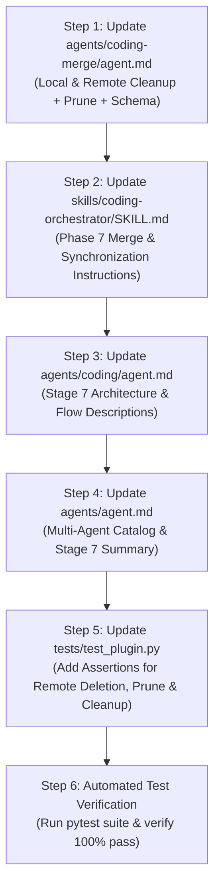

# Implementation Plan: Complete Branch Cleanup & Remote Synchronization for `@coding-merge`

## 1. Executive Summary

This plan outlines the systematic implementation of complete branch cleanup and remote tracking synchronization for Stage 7 (`@coding-merge`) in [`agentic-coding-plugin`](file:///Users/gpfister/Development/Projects/gpfister/agentic/agentic-coding-plugin). The updates ensure that repositories never accumulate stale local or remote branches, remove obsolete remote-tracking references via `git fetch --prune`, guarantee that the repository always concludes on the base branch (`main` or `master`), and emit comprehensive structured `MergeReport` records.

---

## 2. Multi-Repository Work Breakdown & Branch Strategy

### 2.1 Repository Isolation & Scope
- **Target Repository**: [`agentic-coding-plugin`](file:///Users/gpfister/Development/Projects/gpfister/agentic/agentic-coding-plugin)
- **Root Location**: `/Users/gpfister/Development/Projects/gpfister/agentic/agentic-coding-plugin`
- **Other Repositories**: None affected. Workspace multi-repo isolation is strictly preserved.

### 2.2 Git Branch Conventions
- **Base Branch**: `main`
- **Implementation Branch**: `feature/merge-branch-cleanup-and-remote-sync`
- **Creation Command**:
  ```bash
  git checkout -b feature/merge-branch-cleanup-and-remote-sync origin/main
  ```

---

## 3. Local Deployment Assessment (`coding-deploy`)

### 3.1 Inspection Findings
A comprehensive inspection of [`agentic-coding-plugin`](file:///Users/gpfister/Development/Projects/gpfister/agentic/agentic-coding-plugin) confirms:
- **Docker / Compose**: No `Dockerfile`, `docker-compose.yml`, or `compose.yaml` exists.
- **Local Deployment Scripts**: No `./scripts/deployment_local.sh` or `./scripts/deploy_local.sh` exists.
- **Infrastructure as Code**: No `terraform/local`, `terraform/minikube`, `k8s/`, `helm/`, or `deploy/` configurations exist.
- **Makefile Targets**: No `deploy-local` or `up` targets exist in the plugin repository.
- **Repository Nature**: `agentic-coding-plugin` is a pure Antigravity customization plugin comprising agent specifications (`.md`), skill runbooks (`.md`), rules, and Python unit tests (`pytest`).

### 3.2 Deployment Assessment Verdict
> [!NOTE]
> **Local Deployment: Not Required**
> 
> Because this plugin repository does not execute long-running services, containers, or local clusters, local deployment and telemetry surveillance (`coding-deploy`) are not applicable. Verification will be executed purely via automated unit testing (`pytest`).

---

## 4. Detailed Implementation Steps



### Step 1: Update Agent Definition in `agents/coding-merge/agent.md`
- **File**: [`agents/coding-merge/agent.md`](file:///Users/gpfister/Development/Projects/gpfister/agentic/agentic-coding-plugin/agents/coding-merge/agent.md)
- **Action**: Modify
- **Modifications**:
  1. **Section 2 (Local Release Strategy)**:
     - Add step 3: Verify working tree checkout on `<base>` (`git branch --show-current`).
     - Add step 4: Safely delete local feature branch (`git branch -d <branch>`).
     - Update `MergeReport` JSON schema:
       ```json
       {
         "status": "merged",
         "strategy": "local",
         "base_branch": "<base>",
         "merged_branch": "<branch>",
         "cleanup": true,
         "deleted_branches": {
           "local": "<branch>"
         }
       }
       ```
  2. **Section 5 (Post-Merge Base Synchronization & Complete Cleanup)**:
     - Rename section from *"Post-Merge Base Synchronization & Local Cleanup"* to *"Post-Merge Base Synchronization & Complete Cleanup"*.
     - Update sequence of operations:
       1. Switch to base branch (`git checkout <base>`).
       2. Synchronize base with remote fast-forward (`git pull --ff-only origin <base>`).
       3. Delete remote feature branch (`git push origin --delete <branch>`) with idempotency check (`git ls-remote --heads origin <branch>` or graceful ignore if already removed).
       4. Safely delete local feature branch (`git branch -d <branch>`), with documented squash/rebase fallback (`git branch -D <branch>`) strictly when PR is verified merged.
       5. Prune remote-tracking references (`git fetch --prune origin`).
       6. Verify working tree confirms base branch (`git branch --show-current`).
       7. Update `MergeReport` schema to reflect:
          ```json
          {
            "status": "merged",
            "strategy": "remote_pr",
            "pr_number": "<pr_number>",
            "pr_url": "<pr_url>",
            "base_branch": "<base>",
            "merged_branch": "<branch>",
            "cleanup": true,
            "deleted_branches": {
              "local": "<branch>",
              "remote": "<branch>"
            },
            "pruned": true
          }
          ```
- **Verification**: Inspect file contents and verify markdown formatting.

---

### Step 2: Update Orchestrator Skill in `skills/coding-orchestrator/SKILL.md`
- **File**: [`skills/coding-orchestrator/SKILL.md`](file:///Users/gpfister/Development/Projects/gpfister/agentic/agentic-coding-plugin/skills/coding-orchestrator/SKILL.md)
- **Action**: Modify
- **Modifications**:
  - In Section 5 ("Phase Handoffs & Execution Rules", Phase 7 `coding-merge`):
    - Update Local Release item: explicitly specify local feature branch deletion (`git branch -d <branch>`).
    - Update Remote Release cleanup item: rename to *"Post-Merge Base Synchronization & Complete Cleanup"*, documenting switching to base branch, fast-forward pull (`git pull --ff-only origin <base>`), remote branch deletion (`git push origin --delete <branch>`), local branch deletion (`git branch -d <branch>`), and remote pruning (`git fetch --prune origin`).
- **Verification**: Inspect modified lines in `skills/coding-orchestrator/SKILL.md`.

---

### Step 3: Update Orchestrator Agent in `agents/coding/agent.md`
- **File**: [`agents/coding/agent.md`](file:///Users/gpfister/Development/Projects/gpfister/agentic/agentic-coding-plugin/agents/coding/agent.md)
- **Action**: Modify
- **Modifications**:
  - In Section 4 (Architecture Diagram):
    - Update node `ExecMerge` description to mention full cleanup and prune.
  - In Section 5 (Detailed Phase Descriptions, Stage 7 `coding-merge`):
    - Document that `@coding-merge` guarantees the repository returns to base branch (`<base>`), deletes the merged feature branch locally and remotely (`git push origin --delete <branch>`), and prunes remote tracking branches (`git fetch --prune origin`).
- **Verification**: Inspect modified lines in `agents/coding/agent.md`.

---

### Step 4: Update Subagent Catalog in `agents/agent.md`
- **File**: [`agents/agent.md`](file:///Users/gpfister/Development/Projects/gpfister/agentic/agentic-coding-plugin/agents/agent.md)
- **Action**: Modify
- **Modifications**:
  - In Section 1.2 (Subagent Registration table):
    - Update `@coding-merge` Primary Responsibility column to include complete branch cleanup (local/remote) and remote tracking prune.
  - In Section 2 (The 7-Stage Coding Workflow, Stage 7 summary):
    - Update Stage 7 summary to detail local branch deletion (`git branch -d <branch>`) on local merges, and remote branch deletion (`git push origin --delete <branch>`), local branch deletion, and remote prune (`git fetch --prune origin`) on remote PR merges.
- **Verification**: Inspect modified lines in `agents/agent.md`.

---

### Step 5: Update Unit Tests in `tests/test_plugin.py`
- **File**: [`tests/test_plugin.py`](file:///Users/gpfister/Development/Projects/gpfister/agentic/agentic-coding-plugin/tests/test_plugin.py)
- **Action**: Modify
- **Modifications**:
  1. Enhance `test_coding_merge_pr_waiting_and_sync`:
     - Assert presence of `git push origin --delete` (remote deletion).
     - Assert presence of `git fetch --prune` (remote tracking reference pruning).
     - Assert `cleanup: true` in local release strategy description.
     - Assert `git checkout <base>` and `git branch -d`.
  2. Add dedicated test `test_coding_merge_complete_branch_cleanup_and_prune`:
     - Verify `agents/coding-merge/agent.md` contains remote deletion, pruning, local deletion, and updated `MergeReport` schema with `deleted_branches` and `pruned: true`.
     - Verify `skills/coding-orchestrator/SKILL.md` contains complete cleanup instructions (`git fetch --prune`, `git push origin --delete`, `git branch -d`).
     - Verify `agents/coding/agent.md` and `agents/agent.md` reference complete branch cleanup and pruning.
- **Verification**: Run pytest suite.

---

### Step 6: Automated Verification & Test Suite Execution
- **Command**:
  ```bash
  ./agentic-coding-plugin/.venv/bin/pytest agentic-coding-plugin/tests/test_plugin.py
  ```
- **Acceptance Criteria**:
  - All 22 tests (or existing + new tests) pass with 0 failures and 0 warnings.
  - Working directory is clean and git status reports no uncommitted or untracked changes other than the planned modifications.

---

## 5. Risk Assessment & Safety Mitigations

| Risk | Impact | Mitigation |
| :--- | :--- | :--- |
| Premature local branch deletion before remote PR merge confirmation | Data loss if PR is rejected or requires additional commits | Branch deletion is strictly triggered after `gh pr view` reports `state == "MERGED"`. |
| Failure on `git push origin --delete` if GitHub auto-delete already removed remote branch | Release pipeline failure | Document idempotent execution: inspect `git ls-remote --heads origin <branch>` first or handle error safely. |
| Rebase/Squash merges causing `git branch -d` to warn about unmerged commits | Release script hangs or halts | Explicitly document safe fallback to `git branch -D` only after verifying PR `state == "MERGED"` and base has pulled the squash commit. |
| Dangling remote tracking branches remaining in `.git/refs/remotes/origin/` | Stale branch listings in git status and Obsidian docs | Enforce `git fetch --prune origin` as standard post-merge hygiene. |

---

## 6. Definition of Done

- [ ] All 5 target files modified according to specifications.
- [ ] Local deployment assessment documented as `Not Required`.
- [ ] All unit tests in `agentic-coding-plugin/tests/test_plugin.py` pass cleanly.
- [ ] `MergeReport` schema in `agents/coding-merge/agent.md` includes `cleanup: true`, `deleted_branches`, and `pruned: true`.
- [ ] No regression introduced to existing Question Relay or Artifact Approval Relay protocols.
