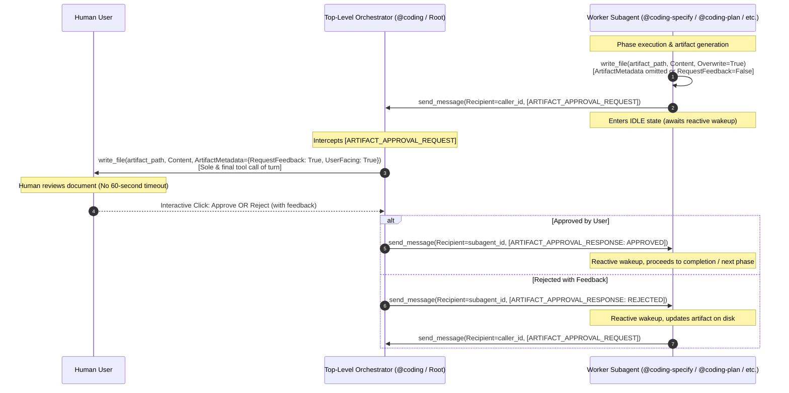

# Implementation Plan: Artifact Approval Relay Protocol

## 1. Executive Summary & Objective

This plan details the implementation of the **Artifact Approval Relay Protocol** across the `agentic` workspace and its companion subagent plugins. 

By standardizing root-orchestrated artifact approval relaying (`[ARTIFACT_APPROVAL_REQUEST]` and `[ARTIFACT_APPROVAL_RESPONSE]`), background worker subagents will no longer block inside tool execution turns with `write_file(RequestFeedback=True)`, eliminating the runtime 60-second execution timeout failure while preserving human-in-the-loop interactive gate reviews.

---

## 2. Architecture & Protocol Specifications

### 2.1 Interaction Architecture



### 2.2 Standardized Envelopes

#### Request: `[ARTIFACT_APPROVAL_REQUEST]`
```json
{
  "type": "ARTIFACT_APPROVAL_REQUEST",
  "artifact_name": "specification.md",
  "artifact_path": "/Users/user/.gemini/antigravity/brain/<session-id>/specification.md",
  "stage": "SPECIFICATION",
  "summary": "Detailed technical specification for feature XYZ",
  "user_facing": true
}
```

#### Response: `[ARTIFACT_APPROVAL_RESPONSE]`
```json
{
  "type": "ARTIFACT_APPROVAL_RESPONSE",
  "artifact_name": "specification.md",
  "status": "APPROVED",
  "feedback": ""
}
```

---

## 3. Local Deployment Assessment Across Repositories

| Repository | Assessment Details | Local Deployment Requirement |
| :--- | :--- | :--- |
| **Workspace Root (`agentic`)** | No Dockerfile, docker-compose, local scripts, or container definitions found. Automation targets git repo synchronization and session extraction. | **Not Required** |
| **`agentic-coding-plugin`** | Python/Antigravity plugin with pytest test suite. No Dockerfiles, Compose specs, or containerization present. | **Not Required** |
| **`agentic-issue-investigation-plugin`** | Python/Antigravity plugin with pytest test suite. No containerization or local deployment manifests present. | **Not Required** |
| **`agentic-project-grooming-plugin`** | Python/Antigravity plugin with pytest test suite. No local deployment infrastructure present. | **Not Required** |
| **`agentic-topic-researching-plugin`** | Python/Antigravity plugin with pytest test suite. No local deployment infrastructure present. | **Not Required** |

> [!NOTE]
> Because no local deployment instructions or container manifests exist across the affected repositories, the `coding-deploy` step will be marked as **Not Required** for all repositories in Phase 5.

---

## 4. Multi-Repository Work Breakdown & Implementation Steps

### 4.1 Repository 1: Workspace Root (`agentic`)
- **Target Git Branch**: `feature/artifact-approval-relay`
- **Local Deployment**: Not Required

#### Files to Modify
- [AGENTS.md](file:///Users/gpfister/Development/Projects/gpfister/agentic/AGENTS.md)

#### Implementation Steps
1. **Add Section 3.3 ("Artifact Approval Relay Protocol")**:
   - Detail the 60-second background execution timeout root cause on `write_file(RequestFeedback=True)`.
   - Embed the sequence flow Mermaid diagram visualizing Orchestrator root presentation vs Subagent background idle states.
   - Define JSON schemas and examples for `[ARTIFACT_APPROVAL_REQUEST]` and `[ARTIFACT_APPROVAL_RESPONSE]`.
   - Include the classification matrix of Pure Subagents vs. Dual-Mode Subagents.
2. **Update Section 4 ("Coding Workflow Pipeline & Decision Flowchart")**:
   - Update flowchart and phase narratives (Phase 2 specify, Phase 3 plan, Phase 5 deploy error gate) reflecting that subagents emit `[ARTIFACT_APPROVAL_REQUEST]` and `@coding` orchestrator presents the interactive gate at root level.

#### Verification
- Run git diff to ensure clean syntax and alignment:
  ```bash
  git diff AGENTS.md
  ```

---

### 4.2 Repository 2: `agentic-coding-plugin`
- **Target Git Branch**: `feature/artifact-approval-relay`
- **Local Deployment**: Not Required

#### Files to Modify
- [rules/AGENTS.md](file:///Users/gpfister/Development/Projects/gpfister/agentic/agentic-coding-plugin/rules/AGENTS.md)
- [skills/coding-orchestrator/SKILL.md](file:///Users/gpfister/Development/Projects/gpfister/agentic/agentic-coding-plugin/skills/coding-orchestrator/SKILL.md)
- [agents/agent.md](file:///Users/gpfister/Development/Projects/gpfister/agentic/agentic-coding-plugin/agents/agent.md)
- [agents/coding/agent.md](file:///Users/gpfister/Development/Projects/gpfister/agentic/agentic-coding-plugin/agents/coding/agent.md)
- [agents/coding-specify/agent.md](file:///Users/gpfister/Development/Projects/gpfister/agentic/agentic-coding-plugin/agents/coding-specify/agent.md)
- [agents/coding-plan/agent.md](file:///Users/gpfister/Development/Projects/gpfister/agentic/agentic-coding-plugin/agents/coding-plan/agent.md)
- [agents/coding-deploy/agent.md](file:///Users/gpfister/Development/Projects/gpfister/agentic/agentic-coding-plugin/agents/coding-deploy/agent.md)
- [tests/test_plugin.py](file:///Users/gpfister/Development/Projects/gpfister/agentic/agentic-coding-plugin/tests/test_plugin.py)

#### Implementation Steps
1. **Update `rules/AGENTS.md`**:
   - Add Section 7 ("Artifact Approval Relay Protocol & Approval Gates") specifying that worker subagents (`@coding-specify`, `@coding-plan`, `@coding-deploy`) must author artifacts directly to disk without `RequestFeedback=True`, dispatch `[ARTIFACT_APPROVAL_REQUEST]` to `caller_id`, and wait for `[ARTIFACT_APPROVAL_RESPONSE]`.
2. **Update `skills/coding-orchestrator/SKILL.md`**:
   - Add handling for `[ARTIFACT_APPROVAL_REQUEST]` in orchestrator lifecycle: read artifact from disk, execute `write_file(Path=artifact_path, Content=..., ArtifactMetadata={"RequestFeedback": True, "UserFacing": True})` as sole and final tool call of turn, await user decision, and dispatch `[ARTIFACT_APPROVAL_RESPONSE]` to subagent via `send_message`.
3. **Update Subagent Prompts & Catalogs**:
   - `agents/agent.md`: Document `[ARTIFACT_APPROVAL_REQUEST]` and `[ARTIFACT_APPROVAL_RESPONSE]` protocol.
   - `agents/coding/agent.md`: Add orchestrator artifact gate presentation loop.
   - `agents/coding-specify/agent.md`: Update Phase 2 instructions to write `specification.md` without `RequestFeedback=True` and dispatch `[ARTIFACT_APPROVAL_REQUEST]`.
   - `agents/coding-plan/agent.md`: Update Phase 3 instructions to write `plan.md` without `RequestFeedback=True` and dispatch `[ARTIFACT_APPROVAL_REQUEST]`.
   - `agents/coding-deploy/agent.md`: Update error handling to write `deployment-issue.md` without `RequestFeedback=True` and dispatch `[ARTIFACT_APPROVAL_REQUEST]`.
4. **Update `tests/test_plugin.py`**:
   - Add unit tests verifying `[ARTIFACT_APPROVAL_REQUEST]` and `[ARTIFACT_APPROVAL_RESPONSE]` in `agents/coding-specify/agent.md`, `agents/coding-plan/agent.md`, `agents/coding-deploy/agent.md`, `agents/coding/agent.md`, `skills/coding-orchestrator/SKILL.md`, `rules/AGENTS.md`, and `agents/agent.md`.

#### Verification
- Run test suite:
  ```bash
  cd agentic-coding-plugin && uv run pytest
  ```

---

### 4.3 Repository 3: `agentic-issue-investigation-plugin`
- **Target Git Branch**: `feature/artifact-approval-relay`
- **Local Deployment**: Not Required

#### Files to Modify
- [rules/AGENTS.md](file:///Users/gpfister/Development/Projects/gpfister/agentic/agentic-issue-investigation-plugin/rules/AGENTS.md)
- [skills/coding-investigate/SKILL.md](file:///Users/gpfister/Development/Projects/gpfister/agentic/agentic-issue-investigation-plugin/skills/coding-investigate/SKILL.md)
- [agents/coding-investigate/agent.md](file:///Users/gpfister/Development/Projects/gpfister/agentic/agentic-issue-investigation-plugin/agents/coding-investigate/agent.md)
- [agents/agent.md](file:///Users/gpfister/Development/Projects/gpfister/agentic/agentic-issue-investigation-plugin/agents/agent.md)
- [tests/test_plugin.py](file:///Users/gpfister/Development/Projects/gpfister/agentic/agentic-issue-investigation-plugin/tests/test_plugin.py)

#### Implementation Steps
1. **Update `rules/AGENTS.md`**:
   - Update Section 2 to specify Dual-Mode Artifact Relay Protocol for `issue-assessment.md`: Subagent Mode (`caller_id` present) writes to disk without feedback gate and relays via `[ARTIFACT_APPROVAL_REQUEST]`; Standalone Mode authors directly with `RequestFeedback=True` as sole & final call.
2. **Update `skills/coding-investigate/SKILL.md`**:
   - Update Step 3 (Approval Gate Artifact) to detail dual-mode behavior and envelope parsing.
3. **Update `agents/coding-investigate/agent.md` and `agents/agent.md`**:
   - Align instructions with dual-mode relaying and envelope handling.
4. **Update `tests/test_plugin.py`**:
   - Add tests asserting presence of `[ARTIFACT_APPROVAL_REQUEST]` and `[ARTIFACT_APPROVAL_RESPONSE]` in `agents/coding-investigate/agent.md`, `skills/coding-investigate/SKILL.md`, `rules/AGENTS.md`, and `agents/agent.md`.

#### Verification
- Run test suite:
  ```bash
  cd agentic-issue-investigation-plugin && uv run pytest
  ```

---

### 4.4 Repository 4: `agentic-project-grooming-plugin`
- **Target Git Branch**: `feature/artifact-approval-relay`
- **Local Deployment**: Not Required

#### Files to Modify
- [rules/AGENTS.md](file:///Users/gpfister/Development/Projects/gpfister/agentic/agentic-project-grooming-plugin/rules/AGENTS.md)
- [skills/project-grooming/SKILL.md](file:///Users/gpfister/Development/Projects/gpfister/agentic/agentic-project-grooming-plugin/skills/project-grooming/SKILL.md)
- [agents/coding-groom/agent.md](file:///Users/gpfister/Development/Projects/gpfister/agentic/agentic-project-grooming-plugin/agents/coding-groom/agent.md)
- [agents/agent.md](file:///Users/gpfister/Development/Projects/gpfister/agentic/agentic-project-grooming-plugin/agents/agent.md)
- [tests/test_plugin.py](file:///Users/gpfister/Development/Projects/gpfister/agentic/agentic-project-grooming-plugin/tests/test_plugin.py)

#### Implementation Steps
1. **Update `rules/AGENTS.md`**:
   - Update Section 3 to document dual-mode approval gate protocol for `Project_Request_Grooming.md`.
2. **Update `skills/project-grooming/SKILL.md`**:
   - Update Step 3 with Subagent Mode relay flow (`[ARTIFACT_APPROVAL_REQUEST]`) and Standalone Mode direct authoring flow.
3. **Update `agents/coding-groom/agent.md` and `agents/agent.md`**:
   - Update instructions to detect caller context and relay artifact approval requests when invoked as a subagent.
4. **Update `tests/test_plugin.py`**:
   - Add tests asserting presence of `[ARTIFACT_APPROVAL_REQUEST]` and `[ARTIFACT_APPROVAL_RESPONSE]` in `rules/AGENTS.md`, `skills/project-grooming/SKILL.md`, `agents/coding-groom/agent.md`, and `agents/agent.md`.

#### Verification
- Run test suite:
  ```bash
  cd agentic-project-grooming-plugin && uv run pytest
  ```

---

### 4.5 Repository 5: `agentic-topic-researching-plugin`
- **Target Git Branch**: `feature/artifact-approval-relay`
- **Local Deployment**: Not Required

#### Files to Modify
- [rules/AGENTS.md](file:///Users/gpfister/Development/Projects/gpfister/agentic/agentic-topic-researching-plugin/rules/AGENTS.md)
- [skills/coding-research/SKILL.md](file:///Users/gpfister/Development/Projects/gpfister/agentic/agentic-topic-researching-plugin/skills/coding-research/SKILL.md)
- [agents/coding-research/agent.md](file:///Users/gpfister/Development/Projects/gpfister/agentic/agentic-topic-researching-plugin/agents/coding-research/agent.md)
- [agents/agent.md](file:///Users/gpfister/Development/Projects/gpfister/agentic/agentic-topic-researching-plugin/agents/agent.md)
- [tests/test_plugin.py](file:///Users/gpfister/Development/Projects/gpfister/agentic/agentic-topic-researching-plugin/tests/test_plugin.py)

#### Implementation Steps
1. **Update `rules/AGENTS.md`**:
   - Update Section 2 to specify dual-mode artifact relay protocol for `research-report.md`.
2. **Update `skills/coding-research/SKILL.md`**:
   - Update Step 4 with dual-mode relaying specifications.
3. **Update `agents/coding-research/agent.md` and `agents/agent.md`**:
   - Add `[ARTIFACT_APPROVAL_REQUEST]` dispatch in subagent mode and direct gate authoring in standalone mode.
4. **Update `tests/test_plugin.py`**:
   - Add tests asserting presence of `[ARTIFACT_APPROVAL_REQUEST]` and `[ARTIFACT_APPROVAL_RESPONSE]` across all documentation and agent files.

#### Verification
- Run test suite:
  ```bash
  cd agentic-topic-researching-plugin && uv run pytest
  ```

---

## 5. Development & Review Lifecycle Sequence

1. **Post-Planning Documentation (`coding-document`)**:
   - Upon approval of this plan, invoke `@coding-document` to document architecture designs, work breakdown, and formalize ADRs in `agentic-obsidian/`.
2. **Phase 4: Parallel Development (`coding-develop`)**:
   - Checkout `feature/artifact-approval-relay` in workspace root and all 4 sub-repositories.
   - Implement the file updates, agent instructions, and test suites across all 5 repositories concurrently.
   - Execute test suites (`uv run pytest`) across all plugins to confirm 100% pass rate.
3. **Phase 5: Local Deployment (`coding-deploy`)**:
   - Skipped as **Not Required** across all repositories.
4. **Phase 6: Quality Review (`coding-review`)**:
   - Perform comprehensive clean code audit and schema verification across all modified files.
   - Prompt user confirmation for merge.
5. **Phase 7: Pre-Merge & Merge (`coding-document` & `coding-merge`)**:
   - Invoke `@coding-document` for pre-merge documentation tidy-up.
   - Fast-forward merge `feature/artifact-approval-relay` into `master` across all repositories.
   - Invoke `@coding-document` for post-merge git status updates.
